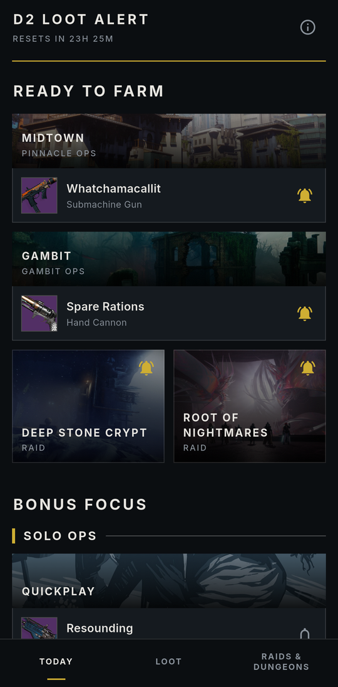
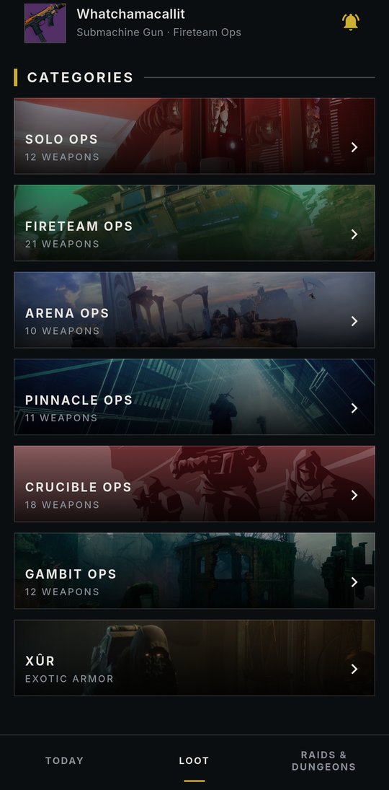
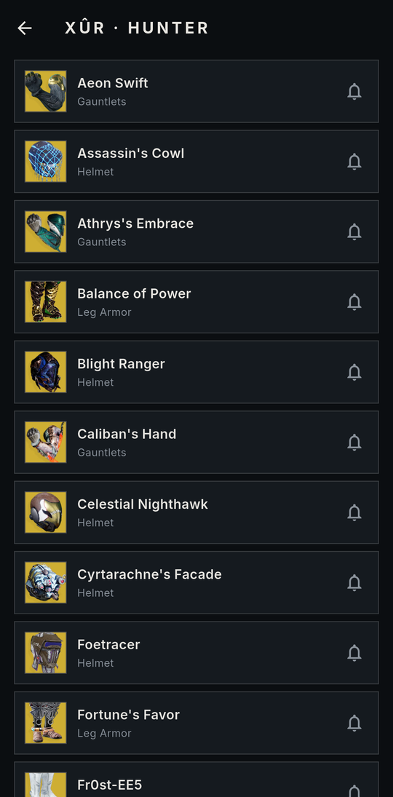
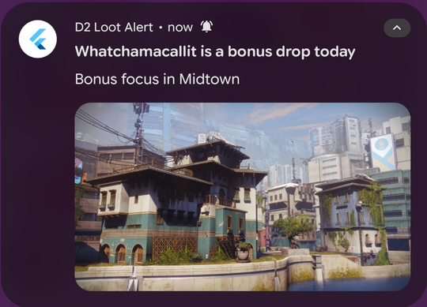

# D2 Loot Alert

A phone app that tells you when the Destiny 2 loot you want is easy to farm, so you don't have to check the game every day.

> **Status:** the Android app works end to end and is in daily use. iOS is next. See [Status](#status).

<p align="center">
  
  
  
</p>

## The problem

Destiny 2 rotates its best farming opportunities on a schedule:

- **Every day**, each activity has a **bonus focus**: one weapon from its loot pool with a much better chance to drop. Spare Rations might be Gambit's focus one day and Bug-Out Bag the next.
- **Every week**, a few older raids and dungeons are **featured**, which makes their loot farmable for that week.
- **Every weekend**, Xûr sells a handful of exotic armor pieces.

If you can't play every day, you either check the game daily or miss the window for the item you want.

## What it does

- **Watch a weapon** and get a push on the day it's a bonus focus, naming every activity where it drops ("Bonus focus in Warden of Nothing and Midtown").
- **Watch a raid or dungeon** and get a push in the week it's featured.
- **Watch an exotic armor piece** and get a push when Xûr sells it.
- **TODAY** starts with **READY TO FARM**: everything you watch that you can get right now. Below it are today's bonus focus activities, grouped like the game's Portal, and this week's featured raids and dungeons.
- **LOOT** lists every Portal category's full weapon pool and every exotic armor piece, each with a bell to watch it.
- **Rich notifications** on Android: the weapon's icon at a glance, and the activity's banner when expanded.

<p align="center">
  
</p>

## How it works

```
 three times a day (shortly after the 17:00 UTC reset, plus two backup runs)
   scheduled Cloud Function (Python) ──► Bungie.net API
        │                                (activities and their visible rewards, Xûr)
        ├──► saves today's rotation and the loot pools to Firestore
        └──► sends a push to each FCM topic with something new
             (weapon_<name>, raid_<name>, xur_<name>)

 the Flutter app
   ├── reads today's rotation and the loot pools (live)
   ├── watching something = subscribing the phone to its topic
   └── draws incoming alerts itself, with the icon and banner
```

- **No accounts and no login.** Watching an item subscribes the phone to a push topic, so the server never stores who watches what.
- **No API key on the phone.** Only the backend talks to the [Bungie.net API](https://github.com/Bungie-net/api), with its key in Cloud Secret Manager.
- **Why a server at all:** iOS doesn't let apps run reliably on a schedule, so the checks happen in the cloud and arrive as pushes on both platforms.

### A few things learned along the way

- **One profile serves everyone.** Weapon bonus focus is the same on every character and matches public trackers, so the backend reads a single player's activities instead of each user's.
- **The game's own categories.** The Portal's categories (Solo Ops, Fireteam Ops…) come from the API's Fireteam Finder tree, so the app groups activities exactly like the game.
- **Weapons are identified by name, not item hash.** Some weapons have several versions (a Grandmaster version next to the regular one), and either one can be the bonus focus.
- **Alerts are sent high priority.** Without it, Android's Doze held them, and only the newest one survived until the phone woke.
- **The app draws its own notifications.** Firebase's built-in ones allow a single image, so Android gets data messages instead, and the app shows the weapon icon collapsed and the activity's banner expanded.
- **Xûr follows his schedule, not the API.** After he leaves on Tuesday, the public endpoint keeps showing his old stock until Friday.

## Tech stack

| Area | Choice |
|---|---|
| App | Flutter (Android, iOS next), custom Destiny-inspired design with the Inter font |
| Backend | Cloud Functions for Firebase (Python 3.11), on Cloud Scheduler |
| Database | Cloud Firestore |
| Notifications | Firebase Cloud Messaging topics, drawn with `flutter_local_notifications` |
| Data source | Bungie.net Platform API |

## Status

| | |
|---|---|
| Backend: daily rotation, loot pools, alerts | Done |
| Android app: Today, Loot, Raids & Dungeons, watch bells, rich notifications | Done |
| Xûr exotic armor alerts | Done |
| iOS: push setup, notification images, TestFlight | Next |
| Android APK release | Planned |

Work is tracked on the [project board](https://github.com/users/BodeKaanta/projects/6).

## Building it yourself

You'll need Flutter, the Firebase CLI, a Firebase project on the Blaze plan, and your own Bungie API key from [bungie.net/en/Application](https://www.bungie.net/en/Application).

**Backend** (`backend/`)
```sh
# Try it locally without Firebase: writes the results to backend/output/
BUNGIE_API_KEY=... BUNGIE_NAME="Name#1234" python backend/rotation.py --dry-run

# Tests (standard library only)
python -m unittest discover backend

# Deploy: store the key and name as secrets, then deploy the function
firebase functions:secrets:set BUNGIE_API_KEY
firebase functions:secrets:set BUNGIE_NAME
firebase deploy --only functions
```

**App** (`app/`)
```sh
# Generates the Firebase config files, which aren't in the repo
flutterfire configure --project=<your-project-id> --platforms=android,ios
flutter run --release
```

[CLAUDE.md](CLAUDE.md) has the full engineering notes: API findings, data shapes, design decisions and their reasons.

## Credits

- Destiny imagery © Bungie, Inc. Weapon icons and activity banners come from the Bungie.net API.
- [Inter](https://rsms.me/inter) font by Rasmus Andersson, under the SIL Open Font License 1.1.

This is a personal project, not affiliated with or endorsed by Bungie. Destiny 2 is a trademark of Bungie, Inc.
